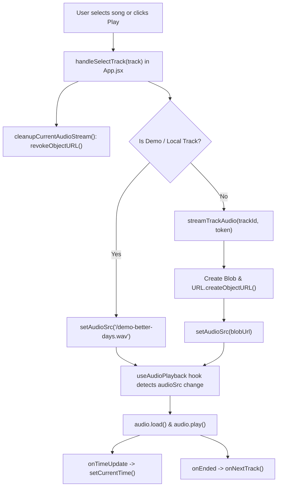

# Architecture Overview

## Design Principles & Patterns
- **Single Source of Truth Audio**: A single HTML5 `<audio>` element rendered at the application root (`App.jsx`), driven by custom hook `useAudioPlayback`. All UI components (Hero Player, Playlist rows, Floating Mini Player) observe and dispatch state to this single engine.
- **Progressive Hydration / Offline-First Fallbacks**: When unauthenticated, the application functions immediately as an authentic Qawwali streaming client with bundled demo assets. Connecting Google Drive seamlessly populates tracks from user cloud folders.
- **Component Separation**: Visual layers are cleanly separated into Presentational and Stateful controllers with minimal prop drilling.

## Component Hierarchy & Layout

```
index.html (GIS OAuth script, Google Fonts)
 └── main.jsx
      └── App.jsx (Root state coordinator)
           ├── <audio> (Global audio DOM node)
           ├── Navbar (Brand crest, navigation tabs, pill search, profile menu)
           ├── Main Content:
           │    ├── [activeTab === 'home']
           │    │    ├── HeroPlayer (Mehfil background, brand logo, transport controls, seek bar)
           │    │    └── TrackList ("All Songs" playlist, filter pills, sort dropdown, track rows)
           │    ├── [activeTab === 'explore']
           │    │    └── ExploreView (Curated Sufi master collections)
           │    └── [activeTab === 'library']
           │         └── TrackList (Full library view)
           ├── MiniPlayerBar (Persistent floating mobile player bar)
           ├── DriveLocationModal (Drive folder manager)
           └── AboutModal (Sufi musical heritage and platform overview)
```

## Audio Playback Pipeline



## State Management Architecture
1. **Audio Playback State** (`useAudioPlayback.js`):
   - `isPlaying`, `isBuffering`, `currentTime`, `duration`, `volume`, `isMuted`, `repeatMode` (`'off'` | `'all'` | `'one'`), `isShuffle`.
2. **Track List & Active Track State** (`App.jsx`):
   - `activeTrack`, `audioSrc`, `isStreamLoading`, `driveTracks`, `isLoadingTracks`, `tracksError`.
   - `currentTrackList`: Derived via `useMemo` (switches between Google Drive tracks and `DEFAULT_DEMO_TRACKS`).
3. **User Preferences & Persistence**:
   - `locations` & `activeLocationId`: Persisted in `localStorage`.
   - `favorites`: `Set` persisted in `localStorage` (`qawwali_favorites`).
4. **Search & Filter State**:
   - `searchQuery` hoisted to `App.jsx`, synchronized between `Navbar` pill search input and `TrackList`.
   - `selectedTag` & `sortBy` scoped to `TrackList.jsx` for responsive localized filtering.
